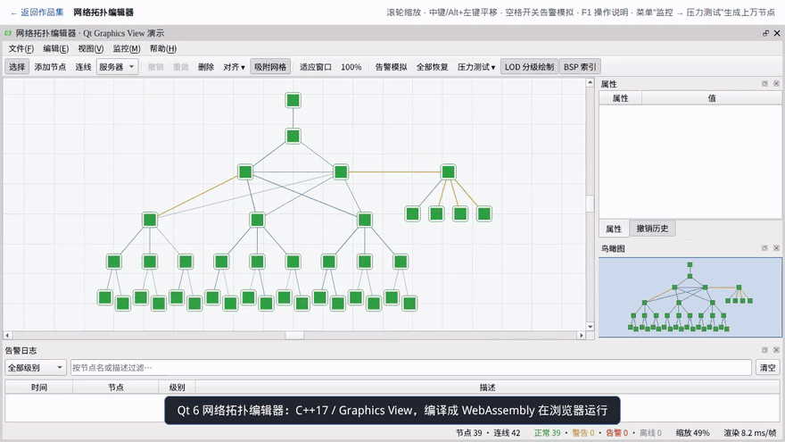
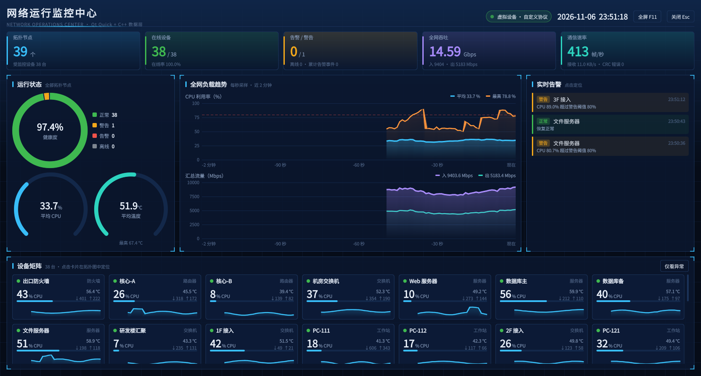

# ai-qt · Qt 网络拓扑编辑器（桌面 + WebAssembly）

用 C++17 / Qt 6 Widgets / Graphics View / Qt Quick 写的网络拓扑编辑与监控程序。**同一套代码**编译成桌面程序和 WebAssembly，浏览器打开就能操作，不用下载安装。

- 在线演示：<https://qt.edgebot.vip/>
- 设计方案：[docs/DESIGN.md](docs/DESIGN.md)



**亮点**

- **Qt Quick 监控大屏**：QML 界面 + C++ 数据层，趋势曲线是自定义 `QQuickItem` 直接生成 Scene Graph 几何体；编辑器（Widgets）和大屏（QML）共用同一份实时数据
- **2 万节点压测**：浏览器版生成 20000 个节点、29793 条连线用时 63 ms，缩放、平移保持流畅
- **一套代码两个平台**：只在文件读写处区分 `Q_OS_WASM`，其余 C++17 代码（约 2300 行）桌面和网页完全共享
- **体积优化**：wasm 26 MB（含 Qt Quick / QML 引擎），gzip 预压缩后 9.8 MB；中文字体按用字做子集，约 800 KB
- **撤销重做**：连续拖动合并成一步，删除节点时连带记录连线，撤销能完整恢复
- **Qt Test 用例**：撤销重做、连线跟随、JSON 往返、错误输入、压测网格、大屏加载与开关等

## 功能

- 节点拖拽、连线、框选、网格吸附、对齐，撤销 / 重做
- 告警仿真：节点状态实时变化、告警闪烁，告警日志可过滤
- 属性面板：按属性类型自动生成编辑控件，修改同样可撤销
- 鸟瞰图导航，滚轮以鼠标为中心缩放，显示 FPS
- 一键生成 20000 个节点做压力测试
- 拓扑导入 / 导出 JSON（网页版走浏览器的文件选择和下载）
- 监控大屏（F10）：指标卡、状态环图、环形仪表、2 分钟负载趋势、实时告警流、设备矩阵；点告警或设备卡片回到拓扑图定位



## 技术要点

| 主题 | 做法 |
|---|---|
| 大规模场景流畅 | `BspTreeIndex` 场景索引 + 视口裁剪；`levelOfDetailFromTransform` 三级 LOD，缩小后节点退化为色块，不画文字和图标 |
| 局部刷新 | 一个全局定时器驱动告警闪烁，只 `update()` 处于告警状态的节点；连线在节点移动时增量更新；鸟瞰图 200ms 节流刷新 |
| 撤销重做 | `QUndoCommand`：连续拖动用 `mergeWith` 合并成一步；删除节点时一并记录关联连线；对齐用宏命令 |
| Model / View | 自定义 `QAbstractTableModel` + delegate 编辑属性；告警日志用 `QSortFilterProxyModel` 过滤 |
| QML 与 C++ | 大屏是 QML 模块 `Topology.Dashboard`（`qt_add_qml_module`，qmlcachegen 预编译）；数据门面 `DashboardBackend` 用 `QML_SINGLETON` + `create()` 把已有的 C++ 对象交给 QML；设备列表是 `QAbstractListModel`，数据不变时只发 `dataChanged`；`QML_ELEMENT` 注册类型，qmllint 零警告 |
| 自定义 Scene Graph 渲染 | `TrendItem` 在 `updatePaintNode` 里直接生成顶点：折线按法线挤出成三角形，两侧 1px 羽化做抗锯齿，下方渐变填充；软件渲染后端（无 GPU）自动改用 `QSGRenderNode` + QPainter |
| 大屏刷新策略 | 趋势每秒采样一次，大屏关着也在采，打开就有 2 分钟历史；KPI 和卡片只在大屏打开时刷新；大屏是独立窗口，关闭即销毁 QML 引擎 |
| 跨平台 | 只在文件读写处用 `#ifdef Q_OS_WASM` 区分，其余代码完全共享 |
| WASM 中文显示 | WASM 没有系统字体：GB2312 一级常用字 + 源码用到的字做成子集字体，打包进 qrc，约 1MB |
| 构建与部署 | 多阶段 Dockerfile（emsdk 3.1.56 + Qt 6.8.3 → 编译 → nginx），wasm 预压缩（15MB → 5.7MB）；`deploy.sh` 本机构建后 `docker save \| ssh docker load` 传到 VPS，服务器不需要 Qt 工具链 |

## 目录

```
topology-editor/
├── src/
│   ├── main.cpp, MainWindow       入口、菜单 / 工具栏 / 停靠窗口装配
│   ├── scene/                     NodeItem、EdgeItem、TopologyScene、TopologyView、MiniMapView
│   ├── commands/                  撤销重做命令
│   ├── model/                     属性模型与委托、告警日志模型
│   ├── sim/                       告警仿真
│   ├── io/                        JSON 导入导出
│   └── dashboard/                 Qt Quick 监控大屏：QML 界面 + C++ 数据门面、列表模型、Scene Graph 曲线
└── tests/tst_topology.cpp         Qt Test 单元测试
web/                               作品集首页 + 演示外壳页
docker/                            Dockerfile、nginx.conf、Caddyfile
scripts/                           WASM 编译、字体子集化、部署
```

## 编译运行

**桌面版**（需要 Qt 6.6+ 和 CMake，含 Qt Quick / QuickShapes 模块）：

```bash
cmake -S topology-editor -B build-desktop -DCMAKE_PREFIX_PATH=<Qt 安装目录>/gcc_64
cmake --build build-desktop -j
./build-desktop/topology
```

**网页版**（工具链在 Docker 里，本机不用装 Qt / emsdk）：

```bash
./scripts/build-wasm.sh serve      # 首次构建工具链镜像约 10 分钟；之后增量编译，预览 http://localhost:8000
```

**部署**：

```bash
docker compose up -d --build                  # 本机：nginx 提供静态站点，/healthz 为健康检查
./scripts/deploy.sh user@vps                  # 本机构建镜像并传到 VPS
```

国内网络可在 `.env`（从 `.env.example` 复制）里换成镜像源。
